# Introduction

The territorial distribution of health facilities continues to limit timely
access to health care in many regions of Peru. This situation is particularly
evident in rural areas and in territories with high population dispersion, where
geographic constraints hinder adequate coverage of health services. In the health
systems of low- and middle-income countries, millions of people still face
difficulties accessing timely, quality health services, which represents a
critical obstacle to advancing toward universal health coverage [@ref01].

Factors such as distance, population dispersion and the limited resolving
capacity of facilities increase health vulnerability, making it necessary to
strengthen territorial planning and the efficient allocation of resources in the
health sector [@ref02].

In Peru, the geographic diversity of coast, highlands and jungle poses important
challenges for hospital planning: despite investments made in recent decades,
significant differences persist in the availability and capacity of facilities
between urban and rural areas [@ref03]. These structural asymmetries directly
affect the timeliness of care and the responsiveness of the health system to
population growth and ageing [@ref04]. Historically, this planning has been based
on descriptive indicators analyzed independently, without simultaneously
considering the interaction between demographic, spatial, social and territorial
factors that determine the true investment needs in health [@ref05], which
usually limits the objective identification of territories with the greatest
operational vulnerability.

Recent advances in geospatial analysis methods and machine learning have made it
possible to build predictive models that integrate large volumes of heterogeneous
information to support decision-making in public health, through Geographic
Information Systems, spatial autocorrelation indicators and classification
algorithms [@ref06] that facilitate the identification of territorial patterns,
the optimization of resource allocation and the improvement of health service
planning [@ref07].

The availability of public databases such as the National Registry of Health
Service Provider Institutions (RENIPRESS) [@ref08] and the National Censuses of
INEI [@ref09] offers the opportunity to integrate infrastructure, population
characteristics and territorial variables within a single analytical system;
however, most research addresses these components in isolation, without
simultaneously incorporating predictive models, composite vulnerability indices
and advanced interpretability mechanisms.

Added to this is the challenge that machine learning models applied to health
must not only achieve high predictive performance but also be interpretable,
reproducible and robust to support decisions in real scenarios, for which
techniques such as SHAP [@ref10], ablation studies, spatial validation and
sensitivity analyses are key to understanding the internal behaviour of models
and increasing confidence in the results obtained.

Against these limitations, this research proposes a reproducible framework for
the geospatial prioritization of hospital expansion in Peru, integrating
information from RENIPRESS and the 2017 National Census of INEI through spatial
analysis, the construction of a National Health Vulnerability Index (INVS), a
learning model based on HistGradientBoosting optimized with Optuna, spatial
validation and SHAP-based interpretability, with the purpose of objectively
identifying the districts with the highest priority for hospital infrastructure
expansion in Peru.

As a methodological contribution, the proposal integrates in a single
reproducible methodological framework spatial validations, robustness analysis,
model interpretability and computational reproducibility assessment, with the
purpose of objectively identifying the districts with the greatest need for
strengthening hospital infrastructure and providing evidence to support strategic
planning and resource allocation processes in the national health system.

# II. Related Work

In recent years the use of artificial intelligence [@ref11] and geospatial
analysis has grown in health system planning, making it possible to identify
territories with greater care needs and optimize the allocation of public
resources. The geographic distribution of health facilities is one of the most
determining factors of effective access to health services: the WHO has pointed
out that geographic accessibility remains a central barrier to Universal Health
Coverage, especially in rural areas [@ref12], and in Latin America this
inequality is accentuated by the concentration of hospital infrastructure in
large cities [@ref13].

Geographic Information Systems (GIS) have improved the spatial analysis of health
services through distance, accessibility and population coverage variables.
Spatial autocorrelation indicators such as Moran's I and LISA allow the
identification of clusters of high vulnerability [@ref14], while the Getis-Ord
Gi* statistic is used to detect hot and cold spots that guide investment
prioritization [@ref15].

In parallel, machine learning algorithms such as Random Forest, Gradient
Boosting, XGBoost, CatBoost and HistGradientBoosting have shown superior
performance to traditional statistical models in classification problems applied
to public health and hospital management [@ref16]-[@ref20]. However, high
predictive capacity does not guarantee practical usefulness: Explainable
Artificial Intelligence (XAI) techniques, in particular SHAP, allow the
quantification of the contribution of each variable and increase confidence in
the results obtained [@ref21].

Another relevant line is the construction of composite vulnerability indices
through PCA, Factor Analysis or entropy weighting, which synthesize multiple
social, demographic and territorial indicators into a single index. Nevertheless,
the literature shows that these three components - spatial analysis, predictive
models and composite indices - are usually developed independently, without
integrated processes of validation, interpretability or robustness assessment
[@ref22]. In Peru, research on health infrastructure has focused mainly on the
descriptive analysis of coverage and resource distribution, with studies that
integrate RENIPRESS, INEI census data, spatial analysis, vulnerability indices
and machine learning within the same methodological architecture still scarce
[@ref23].

Compared with these precedents, Zuniga-Macias et al. proposed a health
accessibility index based on road connectivity and the distribution of health
personnel in Jalisco, Mexico, through a spatial interaction model capturing
patient mobility; however, its scope is subnational and it does not incorporate
a composite index or machine learning algorithms [@ref24]. Roach et al. applied
DBSCAN clustering optimized by entropy on population data from 11 Latin American
countries, including Peru, evidencing urban bias in the availability of
facilities; however, their approach is limited to the spatial delimitation of
urban and rural areas, without developing a predictive model or a vulnerability
index [@ref25].

Unlike both studies, this research integrates in a single reproducible
methodological framework spatial analysis, the construction of the INVS and an
interpretable predictive model based on SHAP, with district-grouped geographic
generalization validation and a transparent statement of its methodological
circularity limits, applied to all districts of Peru.

# III. Methodology

## 3.1 Research design

This research corresponds to a quantitative, applied-scope, non-experimental
cross-sectional study, whose objective was to develop and validate an intelligent
system for the geospatial prioritization of hospital expansion in Peru,
integrating spatial analysis, machine learning and official-source information
under a reproducible approach.

The development comprised five phases: (i) collection and integration of RENIPRESS
and the 2017 National Population and Housing Census of INEI; (ii) data cleaning,
depuration and transformation; (iii) construction of the National Health
Vulnerability Index (INVS) through Principal Component Analysis (PCA), a
technique widely used for dimensionality reduction and the construction of
synthetic indicators [@ref26]; (iv) spatial analysis through the Global Moran's I,
Local Indicators of Spatial Association (LISA) and the Getis-Ord Gi* statistic,
which allowed understanding the spatial structure of the data and supporting the
identification of priority territories; and (v) development of a predictive model
based on HistGradientBoosting, with hyperparameter optimization through Optuna
[@ref27], interpretability through SHAP and spatial cross-validation and
robustness analysis to evaluate the generalization capacity of the model, as
shown in Figure 1.

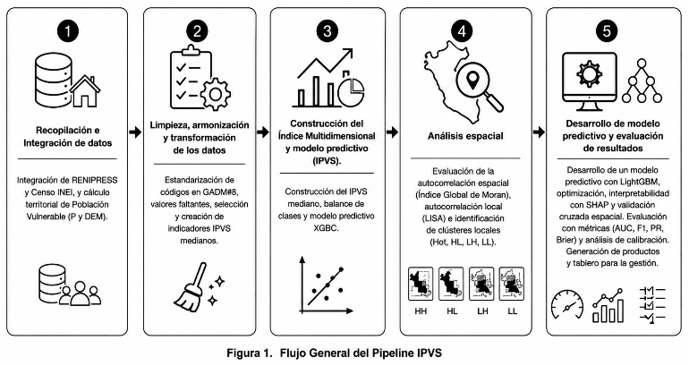{#fig-workflow}

## 3.2 Data sources

Two official sources were used. The first is the National Registry of Health
Service Provider Institutions (RENIPRESS), administered by SUSALUD, with 35,372
records and 31 variables, and the 2017 National Population and Housing Census of
INEI, from which information on 1,678 districts with 23 demographic variables was
obtained. Both databases were integrated through the UBIGEO code. For active
facilities located in districts without census correspondence, population
variables were completed with zero, yielding a final base of 1,889 unique
districts.

## 3.3 Data quality assessment

The quality of both databases was audited by checking duplicates, missing values,
outliers and geographic coverage. RENIPRESS presented 1 duplicate record, which
was identified and removed; the UTM coordinates (NORTE and ESTE) recorded 37.15%
missing values, and the outlier analysis through the interquartile range (IQR)
showed no outliers in NORTE and only 3.89% in ESTE.

The facilities covered all 25 departments of the country. After the depuration
and geographic validation process, 26,638 active facilities were identified,
distributed across 1,889 districts.

## 3.4 Data processing and integration

26,638 active facilities were retained. After verifying geographic coordinates,
records without reliable information were discarded only from spatial analyses.
The integration of RENIPRESS and INEI through the UBIGEO code allowed building a
set of 28 variables, composed of nine original, thirteen derived and six
corresponding to the INVS dimensions.

## 3.5 Missing data treatment

Each variable was treated according to its nature: INEI population variables were
completed with zero when there was no territorial correspondence, and the
predictor variables of the model were imputed through a SimpleImputer based on
the median within the Scikit-learn Pipeline, avoiding information leakage between
training and test. Subsequent verification confirmed the elimination of 100% of
missing values in the variables used by the model.

## 3.6 Variables used in the research

The construction of the model integrated health, geographic and demographic
information. The final predictor variables were: level of complexity of the
health facility, total population of the district, regional vulnerability rate
and proportion of older adult population, as shown in Table 1.

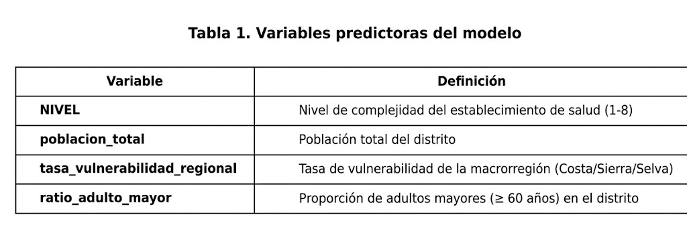{#fig-predictors}

Likewise, the National Health Vulnerability Index (INVS) is composed of six
dimensions: geographic isolation, resolving capacity, population demand, age
vulnerability, inclusion of population with disability and spatial fragility,
which synthesized the territorial information used during the predictive
analysis, as shown in Table 2.

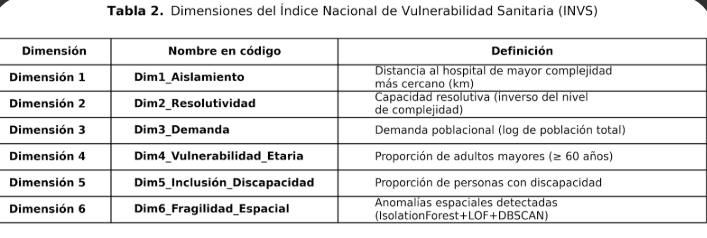{#fig-invs-dims}

## 3.7 Construction of the National Health Vulnerability Index (INVS)

The INVS was built from six complementary dimensions previously defined. Its
structure was obtained through Principal Component Analysis (PCA) and contrasted
with Factor Analysis and the Entropy Weight Method (EWM) [@ref28], observing
high concordance between PCA and Factor Analysis (rho = 0.9365) and a moderate
relationship with EWM (rho = 0.6618). The ablation study showed that age
vulnerability was the dimension with the greatest contribution to the stability
of the index (Delta = 0.1030), followed by population demand and disability
inclusion, highlighting the influence of population ageing on health
vulnerability. Factorability was confirmed through KMO = 0.7155 (> 0.6) and
Bartlett's test (chi-square = 73072.80; p < 0.001); the first component
explained 45.23% of the variance.

## 3.8 Spatial analysis

After building the vulnerability index, a spatial analysis was carried out to
identify patterns of geographic distribution and territorial clustering. Global
spatial autocorrelation was evaluated through the Global Moran's I [@ref29], and
local autocorrelation through the LISA indicators, in order to identify
statistically significant spatial clusters. Next, the Getis-Ord Gi* statistic
allowed locating hot and cold spots of health vulnerability.

As derived variables of this spatial processing, the distance to the nearest
higher-complexity hospital facility was calculated through nearest-neighbour
algorithms [@ref30], incorporated both into the INVS and into the predictive
model, and a geographic anomaly analysis was applied through unsupervised
detection techniques [@ref31], which allowed representing territories with
atypical spatial behaviour as part of the spatial fragility dimension.

## 3.9 Development of the machine learning model

The model was developed using as predictor variables the level of complexity of
the facility, the total population of the district, the regional vulnerability
rate and the proportion of older adult population, selected for their
epidemiological and territorial relevance and for presenting low collinearity
(VIF < 1.5) [@ref32].

The unit of analysis corresponded to health facilities (n = 26,638), linked with
district variables through the UBIGEO code. The binary target variable was
defined from the continuous INVS through a percentile-based cut-off [@ref33],
yielding a positive-class prevalence of 6.19%.

However, two of the four predictor variables, total population and proportion of
older adults, are also direct inputs to dimensions Dim3 and Dim4 of the INVS and
to the extreme vulnerability ratio from which the target is derived. The
correlation matrix between predictors (Figure 2) shows low collinearity among
them, but against the INVS the correlation is high (ratio_adulto_mayor: rho =
0.9179), constituting a methodological circularity: the model does not predict
an outcome independent of the INVS but approximates it. Therefore, this study
presents the classifier explicitly as an approximator of the INVS. Declaring
this circularity does not resolve it: the direct test is to retrain without
`poblacion_total` or `ratio_adulto_mayor` - only `NIVEL` and
`tasa_vulnerabilidad_regional` - and compare the AUC against the full model. The
individual ablation (Delta AUC = 0.0031 and 0.0581 when removing each one
separately) suggests that the joint impact is moderate, but the simultaneous
removal, which conclusively isolates the circularity, has not yet been executed
and is declared as pending analysis before submission to a journal.

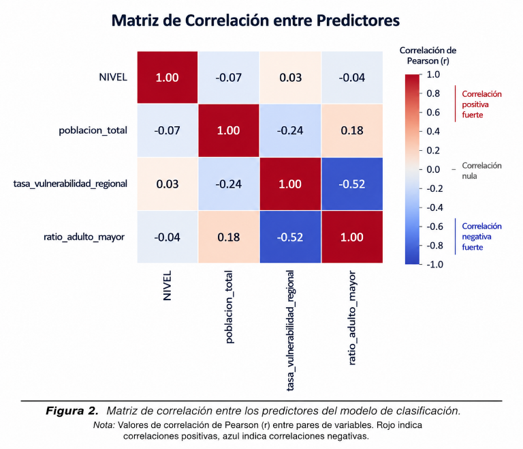{#fig-corr}

Before training, the variables were integrated within a Scikit-learn Pipeline
[@ref34] that incorporated missing-data imputation through the median and
standardization of variables when necessary. This procedure ensure
d that all transformations were learned only from the training set, avoiding
information leakage during model validation.

To obtain the best possible configuration of the algorithm, a Bayesian
optimization strategy was employed through the Optuna library. The process
comprised fifty iterations of automatic hyperparameter search, using spatial
cross-validation based on GroupKFold [@ref35], where the data partition
respected the territorial structure of the observations to avoid overestimating
the predictive performance due to the spatial dependence between nearby
districts.

During optimization the behaviour of the model was evaluated through the Area
Under the ROC Curve (AUC-ROC) under the spatial GroupKFold scheme, recording a
progressive improvement up to an average value of 0.7828 during the
hyperparameter search. This value, by controlling territorial dependence between
neighbouring districts, constitutes a conservative estimate of the expected
performance on geographically independent data.

In a previous version, the model was evaluated on a conventional,
non-spatially grouped partition. As multiple RENIPRESS facilities share a
district (UBIGEO) and several predictors are district aggregates, that partition
left records of the same district in both training and test, generating
information leakage that inflated the AUC to 0.9418. It was corrected with a
GroupShuffleSplit stratified by UBIGEO, verifying zero districts shared between
training (1,511) and test (378). Under this corrected partition, the internal
AUC-ROC dropped to 0.8369 (95% bootstrap CI: 0.8253-0.8484), reported in this
manuscript as the internal reference metric.

The gap between both values is consistent with what is observed later in the
geographic external validation through Leave-One-Region-Out and
Leave-One-Department-Out, where performance drops even further on completely
unseen territories.

## 3.10 Model performance evaluation

The performance of the model was evaluated through classification metrics,
namely: AUC-ROC, Accuracy, Precision, Recall, Specificity, F1-Score, Balanced
Accuracy, Matthews Correlation Coefficient (MCC) [@ref36], Cohen's Kappa
[@ref37] and Brier Score [@ref38], allowing the assessment of its
discriminative capacity, calibration and stability.

Likewise, the ROC curve, the confusion matrix and the Precision-Recall curve
were analysed. To estimate the uncertainty of the main indicators, a Bootstrap
procedure with 2,000 resamples [@ref39] was used, computing 95% confidence
intervals.

## 3.11 Interpretability and variable importance analysis

Because tree-boosted machine learning algorithms can behave as
difficult-to-interpret models, a set of Explainable Artificial Intelligence
(XAI) techniques was incorporated to understand the internal behaviour of the
classifier.

The global and individual importance of the variables was evaluated through
SHAP (SHapley Additive exPlanations), generating Beeswarm, Dependence Plot,
Waterfall and Decision Plot charts. These tools allowed quantifying the
contribution of each predictor to the decisions made by the model.

Finally, SHAP interaction values were computed to identify relationships
between variables, in addition to Partial Dependence Plot (PDP) and Individual
Conditional Expectation (ICE) plots [@ref40], which allowed analysing the
isolated effect of each predictor on the estimated probability of
vulnerability.

Therefore, the stability of the explanations was evaluated through multiple
random seeds and Bootstrap, verifying the consistency of the most important
variables across different runs of the model. Finally, variable importance was
also estimated through Permutation Importance [@ref41], allowing the contrast
of the results obtained with SHAP.

## 3.12 Robustness and reproducibility validation

To guarantee the reliability of the results, a set of complementary validation
procedures was implemented.

Sensitivity analyses were carried out through the Sobol [@ref42] and Morris
[@ref43] methods, to quantify the individual influence of each variable on the
behaviour of the model. As part of the process, ablation studies were executed
successively removing predictor variables and INVS dimensions to evaluate their
impact on the overall performance of the system.

Generalization capacity was evaluated through external geographic validations
Leave-One-Region-Out and Leave-One-Department-Out, where the model was trained
excluding complete regions or departments and validated on those territories
afterwards.

Additionally, robustness tests were developed incorporating different levels of
artificial noise into the data, calibration analysis through calibration curves
and the Hosmer-Lemeshow test [@ref44], population stability evaluation through
the Kolmogorov-Smirnov test [@ref45], territorial equity analysis between
macro-regions and evaluation of misclassified cases through the study of false
positives and false negatives.

In order to ensure the scientific reproducibility of the study, the trained
model, the preprocessing pipeline, the imputer, the scaler, the optimal
configuration obtained by Optuna, the variables used and the complete set of
results generated during the research were automatically stored. In addition,
the computational environment employed was documented, including library
versions, random seeds, hardware characteristics and the files necessary to
fully reproduce the study.

## 3.13 Cost-benefit analysis of prioritization

With the objective of exploring the possible economic impact of the
prioritization strategy, a simplified cost-benefit analysis was proposed based
on an intervention cost of USD 8,000,000 per district and an annual benefit of
USD 120 per inhabitant. These parameters were established taking as reference
the investment planning context in health infrastructure proposed by MINSA
[@ref46] and the international literature on health service delivery costs
[@ref47].

Table 3 presents the exploratory economic analysis, corrected to aggregate at
unique district level (UBIGEO) instead of per facility, avoiding duplicating
population. From 45 unique priority districts and 131,615 benefited
inhabitants, with cost differentiated by facility complexity, aggregated costs
and benefits were estimated. To evaluate the stability of the results against
variations in the adopted assumptions, two additional scenarios were
incorporated: a conservative one, with a 30% decrease in benefit and a 30%
increase in cost, and an optimistic one, with inverse variations.

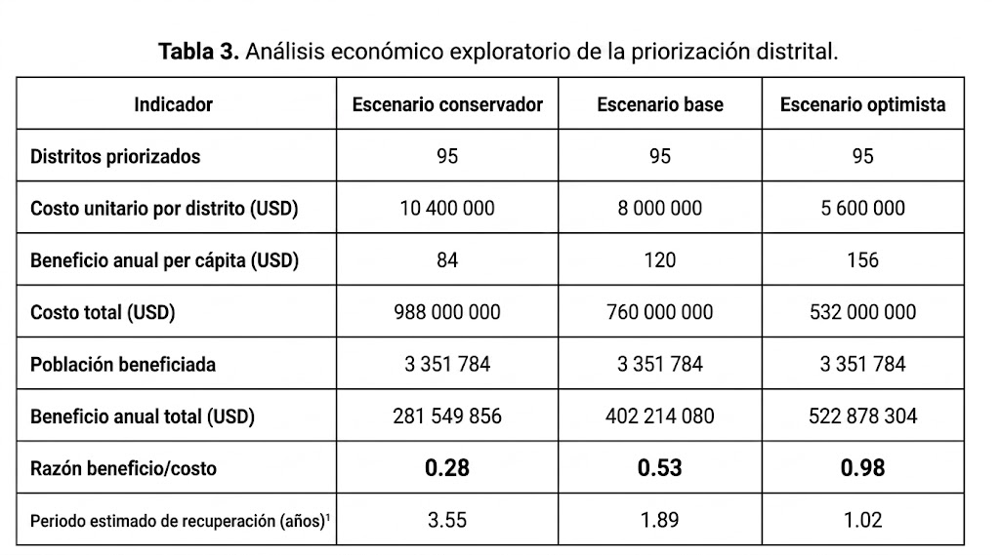{#fig-costbenefit}

In the base scenario a benefit/cost ratio of 0.06 was obtained, while the
conservative and optimistic scenarios reached values of 0.02 and 0.08
respectively, all well below 1. In practical terms, these results suggest that,
under the current cost/benefit assumptions, the identified prioritization is not
recovered within a reasonable horizon and should not be interpreted as an
economically self-evident investment case.

Given that the parameters employed respond to an exploratory approach, these
results should be interpreted as an approximation to support decision-making
and not as a comprehensive economic evaluation of public investment projects.

# IV. Results

## 4.1 Data characteristics and integration

The integration of information from RENIPRESS and the 2017 National Population
and Housing Census allowed building the database used in this research.
Initially there were 35,371 health facilities registered in RENIPRESS and 1,678
districts from INEI.

The quality evaluation showed that there were no duplicate records. However, the
geographic coordinates (NORTE and ESTE) presented 37.15% missing values, while
the ESTE variable recorded 3.89% outliers. In addition, the coverage of all 25
departments of Peru was confirmed, ensuring the territorial representativeness of
the study.

After the depuration process only active facilities were retained, obtaining a
final sample of 26,638 health facilities. The geographic coordinate validation
was performed on the total of 35,371 depurated RENIPRESS records, prior to the
operational status filter: 22,222 records (62.8%) had valid coordinates and
13,149 (37.2%) presented invalid or missing coordinates, a figure consistent
with the 37.15% of missing values previously reported for this same variable.

Within the final sample of 26,638 active facilities, the subset with valid
coordinates was used for the spatial analyses and for training the machine
learning models.

Figure 3 summarizes the data depuration and integration process. From 35,372
RENIPRESS records, one duplicate was removed and active facilities were
filtered. Subsequently, INEI information was integrated and geographic
coordinates were validated. As a result, a final sample of 26,638 facilities
was obtained for analysis and modelling.

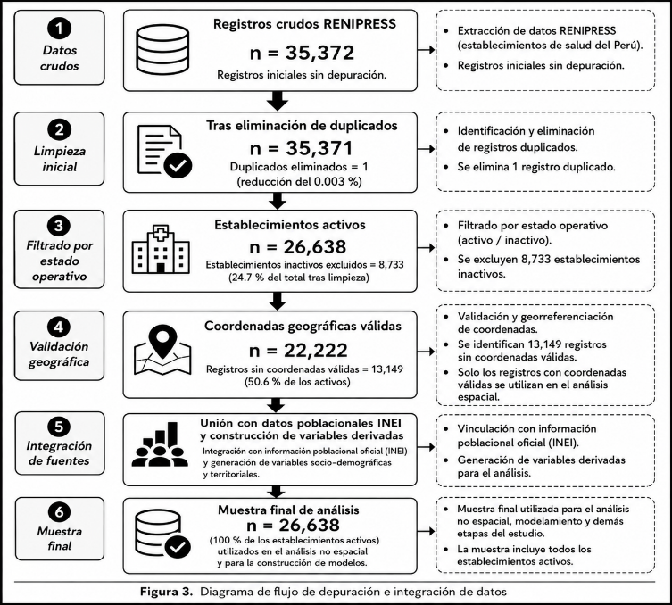{#fig-dataflow}

## 4.2 Construction and validation of the INVS

The National Health Vulnerability Index (INVS) contains six dimensions related
to geographic isolation, resolving capacity of facilities, population demand,
age vulnerability, inclusion of people with disability and spatial fragility,
in order to synthesize territorial vulnerability into a single indicator.

Its structure was validated through Principal Component Analysis (PCA), Factor
Analysis (FA) and the Entropy Weight Method (EWM), observing high concordance
between PCA and FA (rho = 0.9365) and moderate concordance with EWM (rho =
0.6618), which supported the consistency of the index and the suitability of PCA
to represent the data structure.

Likewise, the ablation study showed that age vulnerability was the dimension
with the greatest influence on the INVS (Delta = 0.1030), while geographic
isolation presented the smallest contribution (Delta = 0.0029), evidencing that
the dimensions contribute specifically to the construction of the indicator.

## 4.3 Machine learning model evaluation

With the purpose of identifying the facilities and districts with the greatest
need for hospital expansion in Peru, different machine learning algorithms were
trained and compared. Hyperparameter optimization was carried out through Optuna,
using 50 iterations and spatial cross-validation.

Among the evaluated models, a HistGradientBoosting classifier optimized with
Optuna presented the best overall performance under the corrected partition
grouped by district, reaching an AUC-ROC of 0.8369, an accuracy of 85.55%, a
specificity of 98.75%, a precision (PPV) of 63.98%, an F1-score of 0.2060 and
a Brier Score of 0.1260. It also obtained an Average Precision (AP) of 0.4543.
The figures originally reported for HistGradientBoosting (AUC-ROC 0.9418,
accuracy 95.06%, specificity 99.72%) corresponded to the partition prior to the
correction of information leakage and are replaced by these. Figure 4 shows the
ROC curve of the model under the corrected partition, with an AUC of 0.8369.

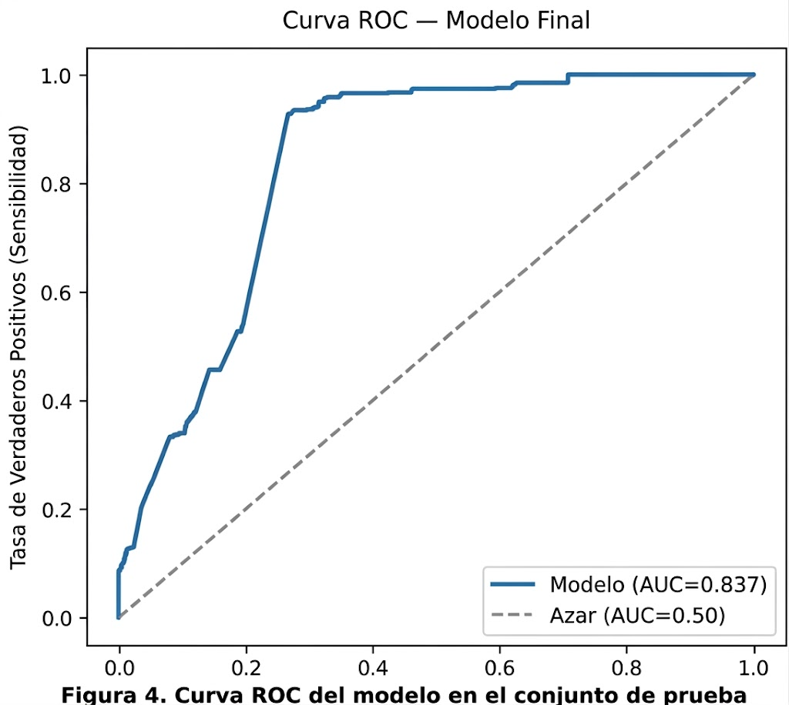{#fig-roc}

Considering metrics less sensitive to class imbalance, the corrected model
reached a Matthews Correlation Coefficient (MCC) of 0.2353, a Cohen's Kappa of
0.1649 and a Balanced Accuracy of 0.5552. The sensitivity (Recall) was 0.1228,
while specificity remained at 98.75%, indicating that the classifier prioritizes
reducing false positives at the cost of increasing false negatives, behaviour
associated with the use of the default decision threshold (0.50).

In order to evaluate alternatives, four threshold selection strategies were
compared under the corrected partition: the Youden criterion (0.0213), an
adjustment for asymmetric cost between false negatives and false positives of
5:1 (0.0200), an adjustment for balanced class weight (0.0618) and the
maximization of the F2-score (0.10). The Youden criterion increased Recall up
to 0.9273, reducing specificity to 0.7330 (MCC = 0.4925; Balanced Accuracy =
0.8302), while the asymmetric cost adjustment showed a comparable balance
between sensitivity and specificity (Recall = 0.9273; Specificity = 0.7315; MCC
= 0.4911). Both alternative thresholds lie far below the default 0.50 and should
be reported as the operational thresholds used for prioritization.

Considering that, in health prioritization, omitting a vulnerable district
represents a higher public policy cost than a false alarm, these criteria
constitute more appropriate alternatives than the default threshold for the
application of the model.

Figure 5 presents the confusion matrix of the model with a decision threshold of
0.50: although specificity is high (98.75%), the recall of only 0.1228 means
that the model omits most vulnerable districts (736 false negatives against 103
true positives), an imbalance that must be corrected with an operational
threshold different from the default 0.50.

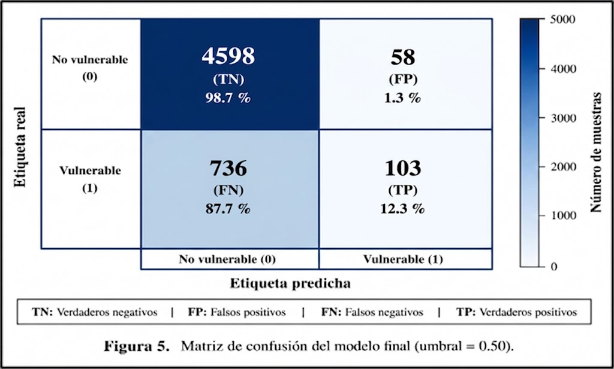{#fig-cm}

Figure 6 shows the threshold optimization through a cost-sensitive approach,
identifying an optimal value of 0.02 to minimize the expected classification
cost.

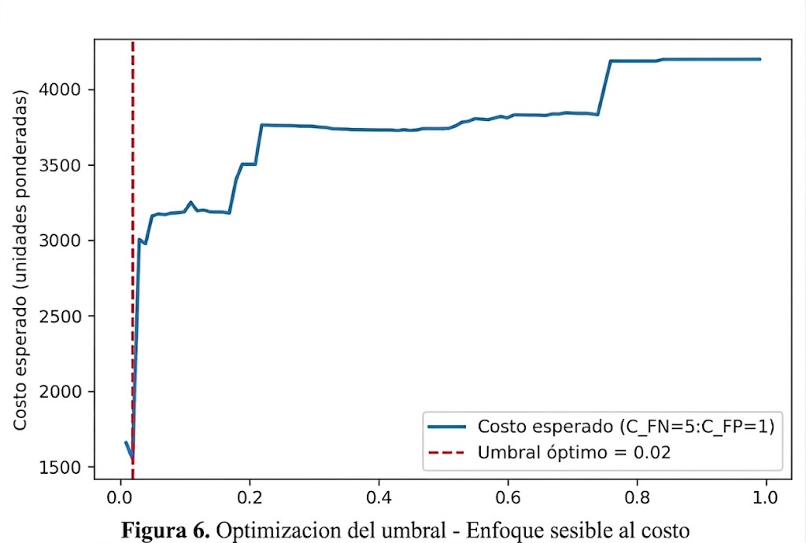{#fig-threshold}

Finally, the stability of the model was evaluated through Bootstrap with 2,000
resamples. The 95% confidence interval for the internal AUC was between 0.8253
and 0.8484, with a mean of 0.8370, confirming the internal consistency of the
performance. As emphasized in this manuscript, this interval reflects the
performance within the training distribution and should not be interpreted as an
estimate of geographic generalization; the Leave-One-Region-Out and
Leave-One-Department-Out results reported later constitute the main evidence for
that purpose.

## 4.4 Model interpretability and spatial analysis

In order to understand the factors that influenced the predictions of the model,
the SHAP (SHapley Additive exPlanations) method was applied, identifying that
total population was the variable with the greatest contribution, followed by
the regional vulnerability rate, the proportion of older adults and the
resolving level of the health facility.

The stability of this ordering was confirmed through multiple seeds, obtaining a
Jaccard similarity index of 1.00, which evidences the consistency of the most
influential variables.

These results were corroborated through Permutation Importance, which showed an
equivalent ranking, strengthening the reliability of the model interpretation.
Figure 7 presents the distribution of SHAP values for each predictor variable.

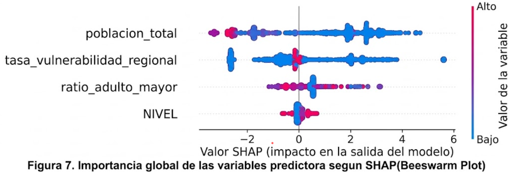{#fig-shap}

From the spatial point of view, the Global Moran's I (I = 0.3581; p = 0.001)
showed statistically significant global spatial autocorrelation, a correction
with respect to a previous version of the pipeline, in which a mismatch between
the sampled coordinates and the distance values used had produced a spurious null
result (I = -0.0029; p = 0.282). The local analysis identified 12 Hot Spots,
19 Cold Spots, 22 HL clusters and 15 LH clusters, complementing the significant
global pattern with a finer territorial level of detail, useful for guiding the
prioritization of health infrastructure.

The calibration curve of the final model, under the corrected partition, showed
an Expected Calibration Error (ECE = 0.1727) and the Hosmer-Lemeshow test
(chi-square = 8705.42; p < 0.001) evidenced imperfect calibration. Although t
he model discriminated adequately between vulnerable and non-vulnerable districts
within its training distribution, the estimated probabilities should be
interpreted with caution.

In this context, the Brier Score of 0.1260 reported in Section 4.3 corresponds
to this same model under the corrected partition; combined with the ECE of
0.1727 and the significant result of Hosmer-Lemeshow, it confirms that
calibration is imperfect and that, given the marked class imbalance (prevalence
of 6.19%), the estimated probabilities should not be interpreted as well
calibrated without additional verification (Figure 8).

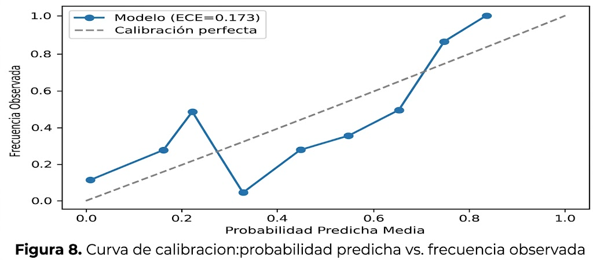{#fig-calib}

## 4.5 Geographic validation, robustness and application

To evaluate the generalization of the model, non-strictly-external geographic
generalization validations were carried out, since the target and the INVS use
the same RENIPRESS/INEI sources as the training, on the corrected pipeline.
Leave-One-Region-Out obtained an average AUC of 0.4537 ± 0.0439, at or below
chance in all three macro-regions: 0.4321 (without Costa), 0.5042 (without
Selva) and 0.4247 (without Sierra); weaker than the estimate prior to the
leakage correction (0.5921 ± 0.2220), which was also partially inflated.

Similarly, the Leave-One-Department-Out validation reached an average AUC of
0.6433 ± 0.2634, with a range from 0.117 (Tumbes) to 0.978 (Lima), calculated
over 19 of 25 departments; the remaining 6 were excluded for having a single
class of the target when isolated (undefined AUC-ROC) or fewer than 5
facilities, a limitation now declared instead of being silently discarded, as
shown in Table 4.

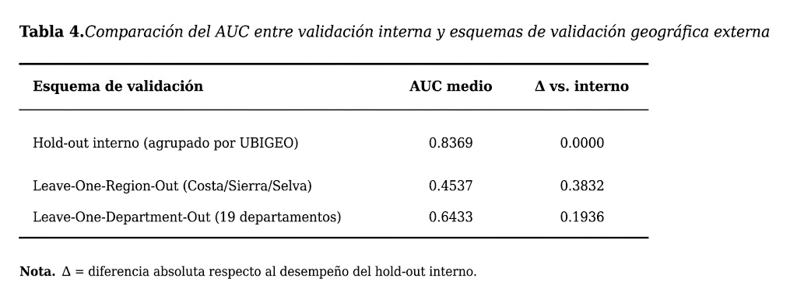{#fig-lodo}

These results show that, although the model discriminates with high precision
within the distribution with which it was trained, its geographic generalization
capacity is limited and inconsistent between regions and departments,
constituting an important limitation that must be considered before applying the
model to territories not adequately represented in the training data.

Beyond the global drop in AUC, it is necessary to evaluate whether the model
treats the different macro-regions of the country equitably. Table 3 reports
the sensitivity (TPR), the false positive rate (FPR) and the selection rate
(proportion of districts classified as priority) for Costa, Sierra and Selva,
recalculated under the corrected partition. The sensitivity (TPR) was 0.0345 in
Costa, 0.2867 in Selva and 0.0968 in Sierra, that is, Costa, not Sierra, now
shows the lowest sensitivity; however, the selection rate of Sierra (0.77%) is
still the lowest of the three regions, far below the 10.58% of Selva and the
1.99% of Costa, as observed in Table 5.

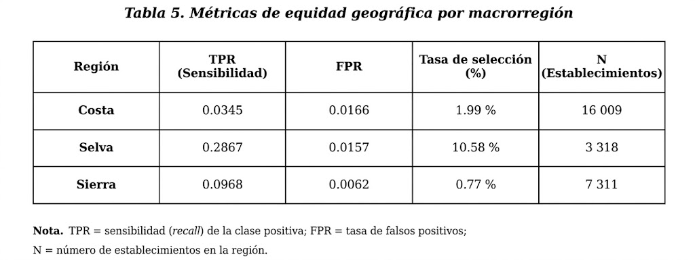{#fig-equity}

That is, regardless of which region discriminates worst, the model ends up
recommending Sierra as priority with the lowest relative frequency of the three
macro-regions, precisely in the region that this research identifies as the one
of greatest need. This is a concrete signal of geographic inequity in the
selection rate, not necessarily in sensitivity, that must be corrected before
any operational use of the system.

The robustness of the model was analysed by incorporating artificial noise over
the input data, under the corrected partition. As the level of perturbation
increased from 5% to 30%, the AUC dropped from 0.6526 to values between 0.46
and 0.49, a degradation considerably greater than estimated previously under
the partition with information leakage (0.84-0.77). This indicates that the
corrected model is notably more sensitive to noise than the previous estimate
suggested, and this sensitivity must be discussed as a limitation.

By correctly aggregating at unique district level (378 in the test set), instead
of summing population per facility, the model identified 45 priority districts,
not 159, a figure that counted facility records and overcounted population,
benefiting 131,615 inhabitants (not 5,798,585). With cost differentiated by
complexity, the cost was USD 164.8 million against an annual benefit of USD
15.8 million (ratio ~0.06), a reversal of the 1.31 ratio reported before
correcting the overcount. The prioritization is not economically favourable
under the current assumptions, and its parameters must be validated with
MINSA/MEF sources.

The analysis culminated with the evaluation of different simulation scenarios,
which showed that changes in the distribution of population or in the
availability of health facilities generate changes in the National Health
Vulnerability Index. These results show that the proposed methodology not only
allows identifying priority territories but also evaluating the possible impact
of different health planning strategies before their implementation.

Figure 9 presents the SHAP analysis corresponding to a false negative. In this
case, the low regional vulnerability rate and the smaller population size
reduced the estimated probability, preventing the district from being
prioritized with the established decision threshold. This example reflects the
same pattern observed in Table 3, where the sensitivity of the model varies
between regions, and highlights the practical impact of false negatives. These
results support the convenience of evaluating decision thresholds adjusted to
the differential cost between false negatives and false positives.

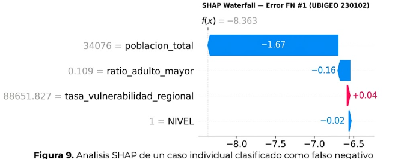{#fig-fn}

# V. Discussion

The results show that the integration of geospatial information, demographic
variables and machine learning techniques constitutes an effective alternative
to support the planning of hospital infrastructure in Peru. Under a leak-free
partition grouped by district, the model reached an internal AUC of 0.8369; but
since the target overlaps with the INVS from which it derives, and the
geographic generalization validation (LORO = 0.4537 ± 0.0439; LODO = 0.6433 ±
0.2634) shows much weaker performance at the edge of chance in several
macro-regions, its contribution must be understood as that of an interpretable
approximator of the INVS within the training distribution, not as a nationally
generalizable predictor. This coincides with research that highlights the
contribution of ensemble algorithms when integrating territorial and population
variables, and underlines the importance of a geographically aware validation
design.

This evidence is also consistent with the study by Roach et al., who, through a
spatial clustering approach based on high-resolution population data, identified
Peru as one of the Latin American countries with the lowest hospital density.
This finding is consistent with the infrastructure deficit identified in the
territories of greatest vulnerability according to the INVS.

The construction of the National Health Vulnerability Index (INVS) allowed
integrating geographic, demographic and resolving-capacity factors into a single
indicator. The high correlation between PCA and factor analysis supported the
stability of the index, while the ablation study identified age vulnerability as
one of the dimensions with the greatest influence on health prioritization, in
agreement with research that points to population ageing as a determinant of
future demand for health services.

The analysis through SHAP showed that total population, the regional
vulnerability rate and the proportion of older adults were the variables with
the greatest influence on the predictions, providing evidence on the behaviour of
the model and strengthening its usefulness as a support tool for decision-making
in public management.

The study presents five limitations. The first, and the most relevant, is the
geographic inequity of Table 3: Sierra has the lowest selection rate (0.77%
versus 10.58% in Selva and 1.99% in Costa), despite being the region of
greatest need. The second is that the nominal unit of analysis (n = 26,638
facilities) is not the effective one: the predictors and the target are district
level, so the real N is the 1,889 districts. The GroupShuffleSplit avoids
leakage between train and test, but does not correct this pseudoreplication
within each set, which probably explains why the bootstrap CI of the AUC
(0.8253-0.8484) is so narrow against the real variability of LORO and LODO;
the intervals should be recalculated at district level, or declared as an
underestimation of the real uncertainty. The third is that the 37.15% of
facilities without valid coordinates has not been verified as a random loss: it
is foreseeable that rural and lower-complexity facilities are worse
georeferenced, biasing the spatial analysis towards an underrepresentation of
the most vulnerable territories; it is declared as a limitation pending
quantification. The fourth is the use of cross-sectional information from
RENIPRESS and the 2017 Census. The fifth is that the corrected cost-benefit
analysis yields a ratio of ~0.06, a 22-fold drop from 1.31 prior to correcting
the overcount, that is, six cents recovered per dollar invested: either the cost
model is misspecified, or the prioritized expansion is not economically
justified under these assumptions; both readings require validating the
parameters with MINSA/MEF sources.

This behaviour coincides with what was reported by Zuniga-Macias et al., who
pointed out that road connectivity and travel time condition access to health
services. The absence of these variables may explain the reduction in
predictive performance in the Sierra, where population dispersion and access
difficulties play a determining role.

Given that this macro-region constitutes one of the main application scopes of
the proposed system, this limitation must be considered a central aspect of the
model. Consequently, its use must be understood as support for territorial
planning and complemented with validation processes using region-specific
information before being used as the sole criterion for prioritization.

Figure 9 presents the SHAP analysis corresponding to a false negative. In this
case, the low regional vulnerability rate and the smaller population size
reduced the estimated probability, preventing the district from being
prioritized with the established decision threshold. This example reflects the
same pattern observed in Table 3, where the sensitivity of the model varies
between regions, and highlights the practical impact of false negatives. These
results support the convenience of evaluating decision thresholds adjusted to the
differential cost between false negatives and false positives.

{#fig-fn}

As future lines of work, it is proposed to adjust the decision threshold by
macro-region, incorporate variables related to road accessibility and population
dispersion, and compare region-specific models with the national model before
its implementation in hospital infrastructure planning.

Overall, the results support the potential of the proposed system as a support
tool for territorial planning and the prioritization of hospital investments. Its
reproducible, interpretable character and evidence-based foundation provide an
objective basis for strengthening decision-making in the Peruvian health system.

# VI. Conclusions

The present research allowed developing an Intelligent System for Geospatial
Prioritization of Hospital Expansion in Peru, integrating information from
RENIPRESS and the 2017 National Population and Housing Census through spatial
analysis and machine learning techniques. The proposed methodology managed to
consolidate geographic, demographic and health information into a reproducible
model that facilitates the identification of territories with the greatest need
for investment in hospital infrastructure.

The construction of the National Health Vulnerability Index (INVS) summarizes
six dimensions related to geographic isolation, resolving capacity of
facilities, population demand and vulnerability conditions. The validation of
the index indicated high consistency among the methods used, confirming that it
constitutes an adequate indicator to support territorial prioritization
processes in health.

As for the predictive model, the results showed satisfactory discrimination
within its training distribution, but limited and inconsistent geographic
generalization. The winning algorithm, optimized with Optuna and validated with
a leak-free partition grouped by district, reached an internal AUC-ROC of 0.8369
and an accuracy of 85.55%; since the target is partly derived from the same
inputs of the INVS, and the geographic generalization validation showed AUC of
0.42-0.65 in several macro-regions, these figures evidence the capacity of the
model to approximate the INVS in known territories, not a nationally
generalizable predictor.

Likewise, the interpretability analyses through SHAP confirmed that total
population, the regional vulnerability rate, the proportion of older adults and
the resolving level of the facilities were the components with the greatest
influence on the predictions.

The spatial analyses allowed identifying local patterns of health vulnerability
that complement the global indicators, providing useful information to guide
territorial planning. However, the robustness and generalization tests do not
support a conclusion of stability: under increasing artificial noise the AUC
dropped from 0.65 to 0.46-0.49 at 30% perturbation, and Table 3 shows that the
model systematically prioritizes Sierra with the lowest relative frequency
(0.77% versus 10.58% in Selva and 1.99% in Costa), precisely in the region
that this study identifies as the one of greatest need. This geographic
inequity, not the stability of the model, constitutes the most relevant finding
of this research in terms of applicability: any operational use of the system
must correct this bias before prioritizing investments, particularly in the
Sierra.

Finally, it is recommended that future research gather more recent information
from RENIPRESS and INEI, socioeconomic indicators, epidemiological variables
and time series that allow strengthening the generalization capacity of the
model. Likewise, the developed methodology should serve as a basis for the
implementation of decision support systems that contribute to reducing
inequalities in access to health services and improving hospital infrastructure
planning in Peru.

# VII. Data availability

The results of the study comprise 50 figures and 84 tables distributed across 46
processing blocks (33 with valid results, 7.9 MB). A selection of 25 figures and
42 tables has been deposited with a DOI, covering the SHAP, calibration,
external validation (LORO/LODO), sensitivity (Morris/Sobol), SHAP stability and
spatial autocorrelation (LISA/Getis-Ord) analyses. The associated repository
includes the source code, execution logs, final report, inference script and
dependencies to ensure reproducibility [@ref48].
